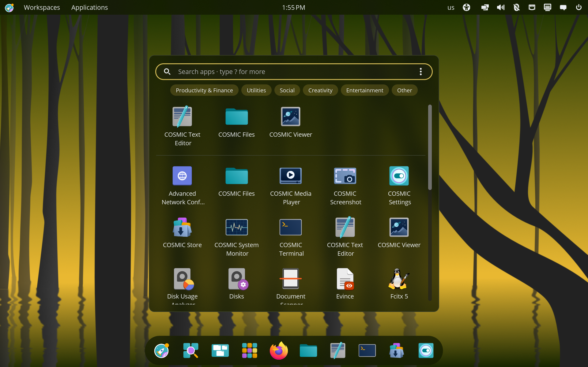
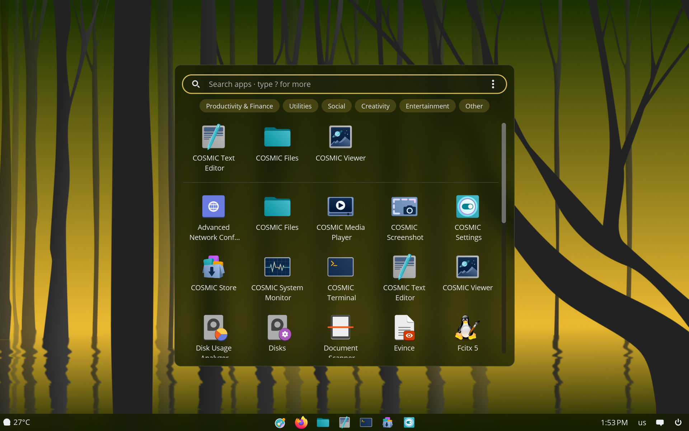
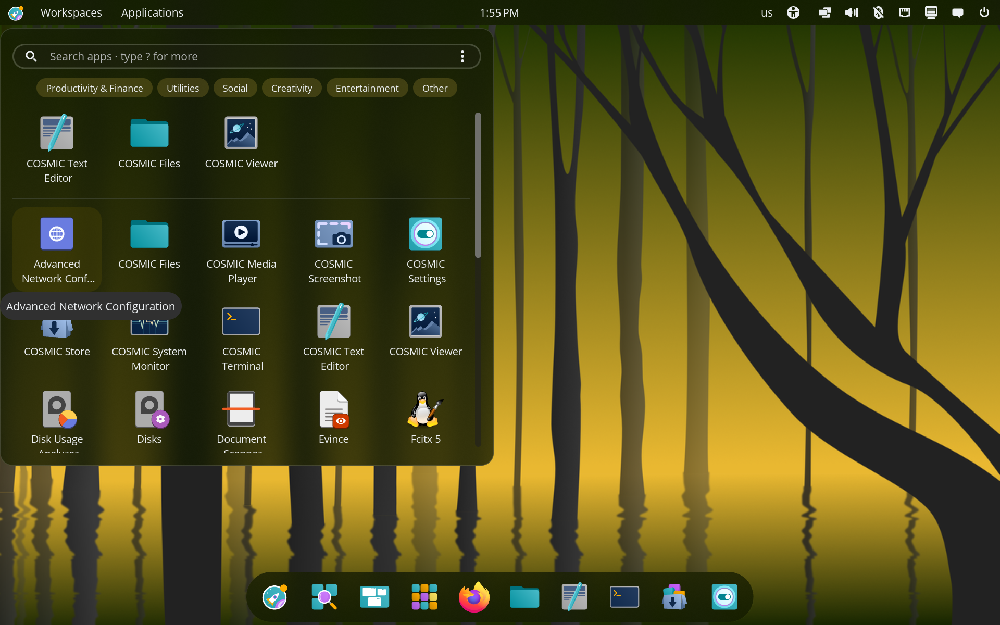
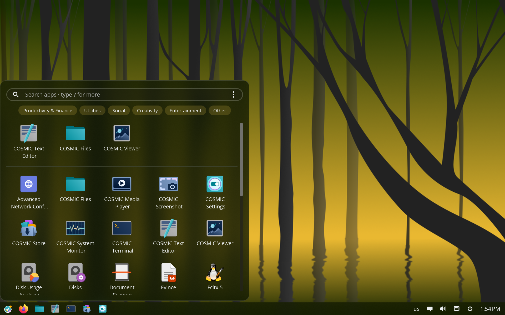
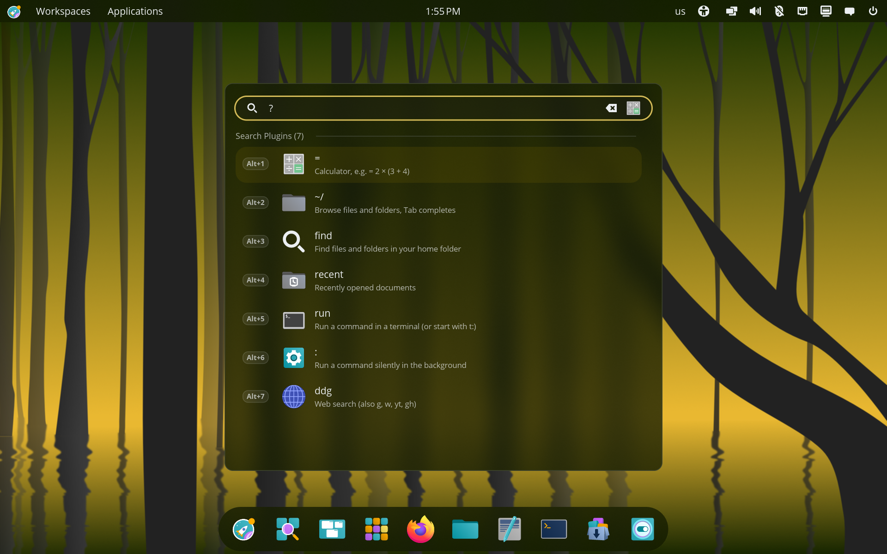
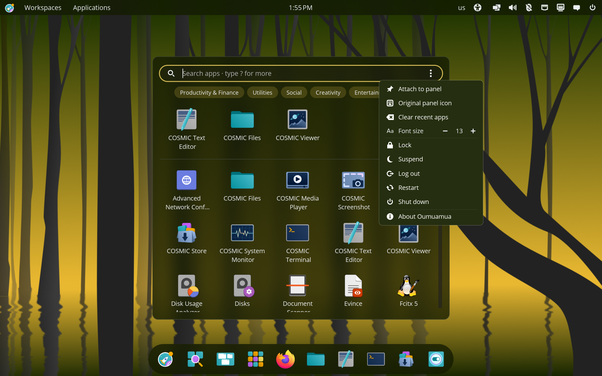

# Oumuamua for the COSMIC™ desktop

A frosted-glass application grid launcher for the [COSMIC™](https://system76.com/cosmic) desktop, written in Rust with [libcosmic](https://github.com/pop-os/libcosmic). It's inspired by [Plasma 6 AppGrid](https://github.com/xarbit/plasma6-applet-appgrid).













This is a community project. It is not affiliated with or endorsed by System76.

- **Always centered.** By default the grid opens in the exact middle of the screen, wherever the panel or dock is.
- **Or attached to the panel.** The ⋮ menu in the search field turns it into a popup attached to its panel button, like a Start menu, and back again. With the button at the left of a bottom panel, it opens like the Windows 7 Start menu.
- **AppGrid-style layout.** A search field, category chips (Productivity & Finance, Utilities, Social, Creativity, Entertainment, Other), a row of recently used apps, and a scrolling grid of all apps. App names wrap onto two lines like Plasma's AppGrid, and a tooltip shows the full name when it's cut short.
- **One search field for everything.** Typing searches your apps and open windows. Prefixes turn the field into other tools; type `?` to list them:

  | Type | What it does |
  |---|---|
  | `= 2 × (3 + 4)` or just `2+2` | Calculator. Enter copies the result. |
  | `~/` | Browse files and folders. Tab completes. |
  | `find name` | Find files and folders in your home folder. |
  | `recent` | Recently opened documents. |
  | `run command` or `t:command` | Run a command in a terminal. |
  | `:command` | Run a command silently in the background. |
  | `ddg`, `g`, `w`, `yt`, `gh` + words | Search DuckDuckGo, Google, Wikipedia, YouTube or GitHub. |
  | `reboot`, `lock`, `shut`… | Session and power actions. |
  | part of a window title | Switch to that open window. |

- **Fast keyboard use.** Start typing to search. The arrow keys and Tab move the selection, Enter opens it, Alt+1…9 opens a result directly, Esc closes, and PgUp/PgDn jump a screen.
- **Adjustable font size.** *Font size* in the ⋮ menu goes from 9 to 20, like the spin buttons in COSMIC Settings. Every text in the grid, the results and the menu follows, and the cells grow with it.
- **Glass that follows your desktop settings.** The grid uses COSMIC's own Frosted glass settings (*Settings → Desktop → Appearance → Frosted glass*):
  - The centered grid follows the **System interface** toggle.
  - The panel popup follows the **Applets** toggle.
  - Both use your blur strength and glass opacity, and update live when you change them.
- **Session and power options** in the ⋮ menu: Lock, Suspend, Log out, Restart and Shut down. Log out, Restart and Shut down ask for confirmation with COSMIC's own dialog.
- **Fits every language.** The ⋮ menu and the category chips size themselves to the translated text, so nothing wraps, scrolls or gets cut off.
- **Translated** into Brazilian Portuguese, Spanish, French and Esperanto, with an About page (⋮ → *About Oumuamua*) that links to this repository.
- **Its own icon.** A porthole with a planet and a rocket, inspired by the Pop!_OS installer artwork. It comes in color for a Windows-style bottom panel or dock, or in monochrome to match the other top-panel icons (switch it in the ⋮ menu).
- **Works alongside COSMIC's launcher.** Oumuamua has its own plugins and settings, and doesn't replace or change COSMIC Launcher or the App Library.

## Components

| Binary | What it is |
|---|---|
| `cosmic-ext-oumuamua` | The centered launcher. It runs as a single instance: running it again toggles it open or closed. Bind it to a key in *Settings → Keyboard → Custom shortcuts*. |
| `cosmic-ext-oumuamua-applet` | The panel button, listed as *Oumuamua* in *Settings → Desktop → Panel → Applets*. |

Settings are stored with cosmic-config at `~/.config/cosmic/io.github.broly1.Oumuamua/v1/`:

| Key | Default | Meaning |
|---|---|---|
| `position` | `Centered` | `Centered` or `Panel` |
| `columns` | `5` | Icons per row |
| `rows` | `4` | Rows visible at once (the rest scrolls) |
| `icon_size` | `52` | Icon size in pixels (32–128) |
| `symbolic_icon` | `false` | Use the monochrome panel icon |
| `font_size` | `13` | Font size of the app names (9–20); the rest of the text follows |
| `recent` | `[]` | Recently launched desktop entry IDs, newest first |

Categories come from each app's freedesktop.org `Categories=` key. Office and finance apps go to Productivity & Finance, graphics and development tools to Creativity, browsers, mail and chat to Social, games and media players to Entertainment, and system tools to Utilities. Everything else goes to Other.

## Installation

A [justfile](./justfile) is included for the [casey/just][just] command runner. You need Rust 1.90 or newer and the libcosmic build dependencies. On Pop!_OS / Ubuntu:

```sh
sudo apt install build-essential pkg-config just cmake libxkbcommon-dev libwayland-dev \
  libexpat1-dev libfontconfig-dev libfreetype-dev libegl-dev libdbus-1-dev
just
sudo just install
```

Then add *Oumuamua* to your panel or dock, or run `cosmic-ext-oumuamua`.

- `just` builds the application with the default `just build-release` recipe
- `just run` builds and runs the launcher
- `just install` installs the project into the system
- `just vendor` creates a vendored tarball
- `just build-vendored` compiles with vendored dependencies from that tarball
- `just check` runs clippy on the project to check for linter warnings
- `just check-json` can be used by IDEs that support LSP

## Open it with the Super (Windows) key

COSMIC binds the Super key on its own to its launcher. To open Oumuamua instead, add this to `~/.config/cosmic/com.system76.CosmicSettings.Shortcuts/v1/custom` (create the file if it doesn't exist; keep any other entries already in it):

```ron
{
    (modifiers: [Super]): Spawn("cosmic-ext-oumuamua"),
}
```

Pressing Super again closes the grid. COSMIC's launcher stays available on Super+/. You can also add a custom shortcut for `cosmic-ext-oumuamua` in *Settings → Keyboard → Shortcuts*.

## Translators

Oumuamua uses [Fluent][fluent] for translations, the same way COSMIC's own apps and applets do. Each language has one file, `i18n/<language>/cosmic_ext_oumuamua.ftl`. The same file also translates the app's name and description in the panel's applet list and in app stores.

| Language | Folder |
|---|---|
| English (source) | [`i18n/en`](./i18n/en) |
| Brazilian Portuguese | [`i18n/pt-BR`](./i18n/pt-BR) |
| Spanish | [`i18n/es`](./i18n/es) |
| French | [`i18n/fr`](./i18n/fr) |
| Esperanto | [`i18n/eo`](./i18n/eo) |

To add a language:

1. Copy the `i18n/en` folder and rename it to your language code, for example `de`, `it` or `pt` (use a region only when it matters, as in `pt-BR` or `zh-Hant`). See the [ISO 639-1 codes][iso-codes].
2. Translate the text after each `=`. Keep the IDs before the `=` unchanged. See the [Fluent guide][fluent-guide] for the syntax.
3. In the `*-keywords` lines, keep the `;` between words and at the end.
4. Leave a line out if it doesn't need translating; the English text is used for it.
5. Check your work by running `just run`, or build and install with `just` and `sudo just install`. Oumuamua uses your desktop's language (*Settings → Time & language → Region & language*).
6. Open a pull request.

To fix an existing translation, edit its file and open a pull request.

## Packaging

If packaging for a Linux distribution, vendor dependencies locally with the `vendor` rule, and build with the vendored sources using the `build-vendored` rule. When installing files, use the `rootdir` and `prefix` variables to change installation paths.

```sh
just vendor
just build-vendored
just rootdir=debian/cosmic-ext-oumuamua prefix=/usr install
```

It is recommended to build a source tarball with the vendored dependencies, which can typically be done by running `just vendor` on the host system before it enters the build environment.

## Developers

Developers should install [rustup][rustup] and configure their editor to use [rust-analyzer][rust-analyzer]. Run `just check` (clippy) and `cargo fmt` before sending changes.

## How the centering works

The centered grid is a full-screen Wayland layer surface on the overlay layer with `exclusive_zone = -1`, so panels and docks don't shift it. libcosmic then pads the surface down to the grid's size, with equal padding on each side, and the blur is requested together with that padding so it only ever covers the panel. Clicking outside the grid closes it.

## How this was made

This project was written with the help of an AI coding assistant (Claude, by Anthropic), directed, tested and reviewed by the maintainer. Its code is not intended for submission to System76's COSMIC repositories, which do not accept AI-generated contributions.

## License

GPL-3.0-only. See [LICENSE](LICENSE).

COSMIC™ is a trademark of System76, Inc.

[fluent]: https://projectfluent.org/
[fluent-guide]: https://projectfluent.org/fluent/guide/hello.html
[iso-codes]: https://en.wikipedia.org/wiki/List_of_ISO_639-1_codes
[just]: https://github.com/casey/just
[rustup]: https://rustup.rs/
[rust-analyzer]: https://rust-analyzer.github.io/
