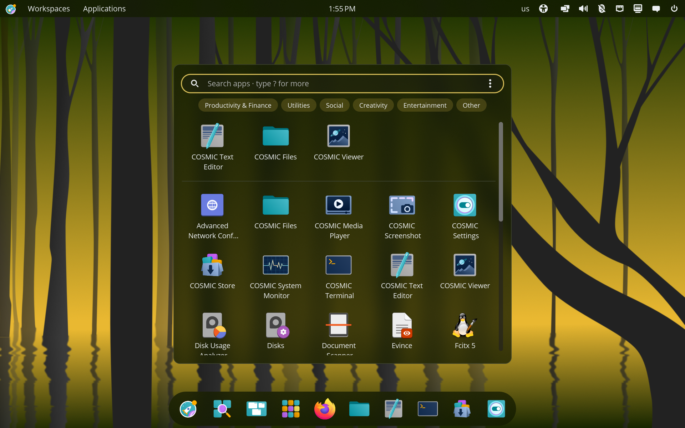
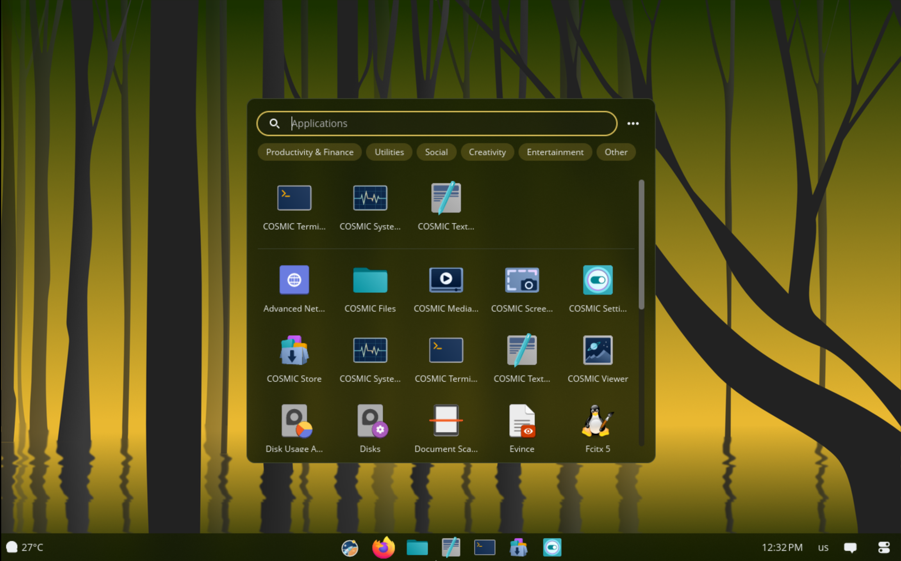
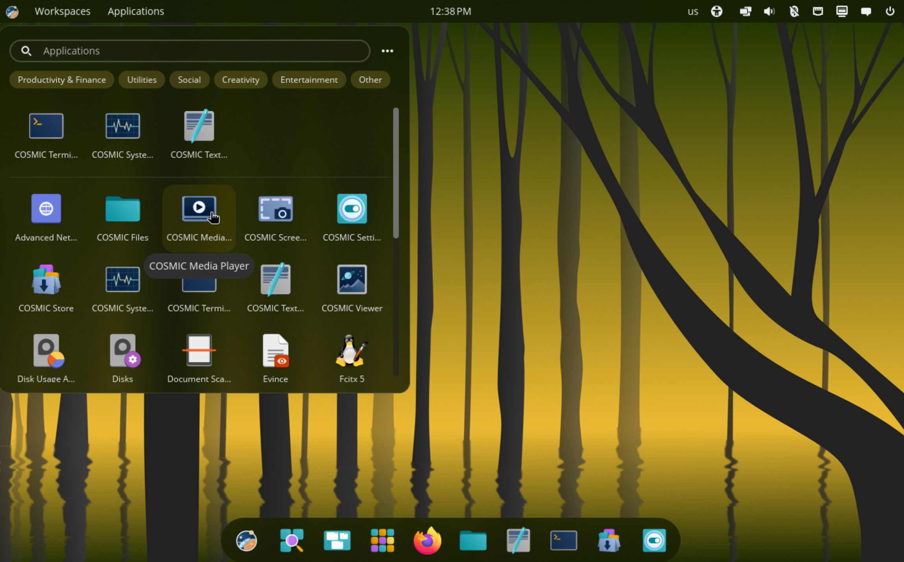
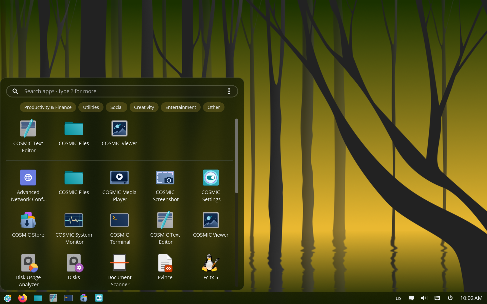
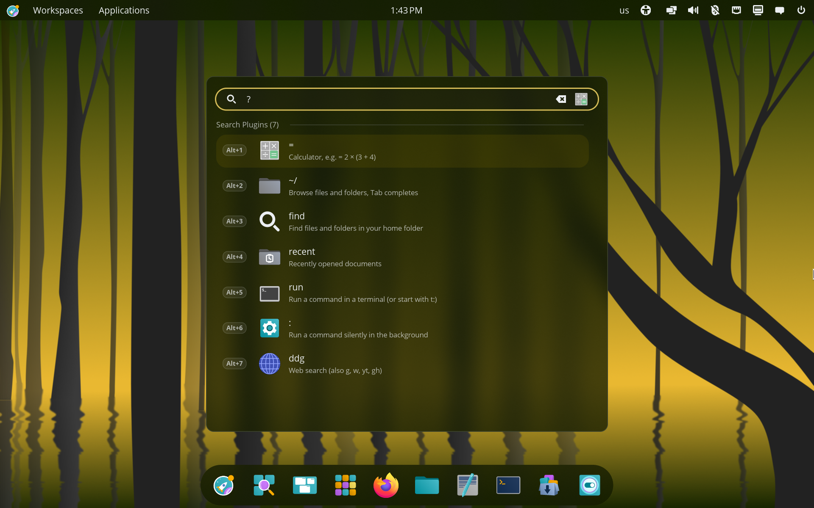
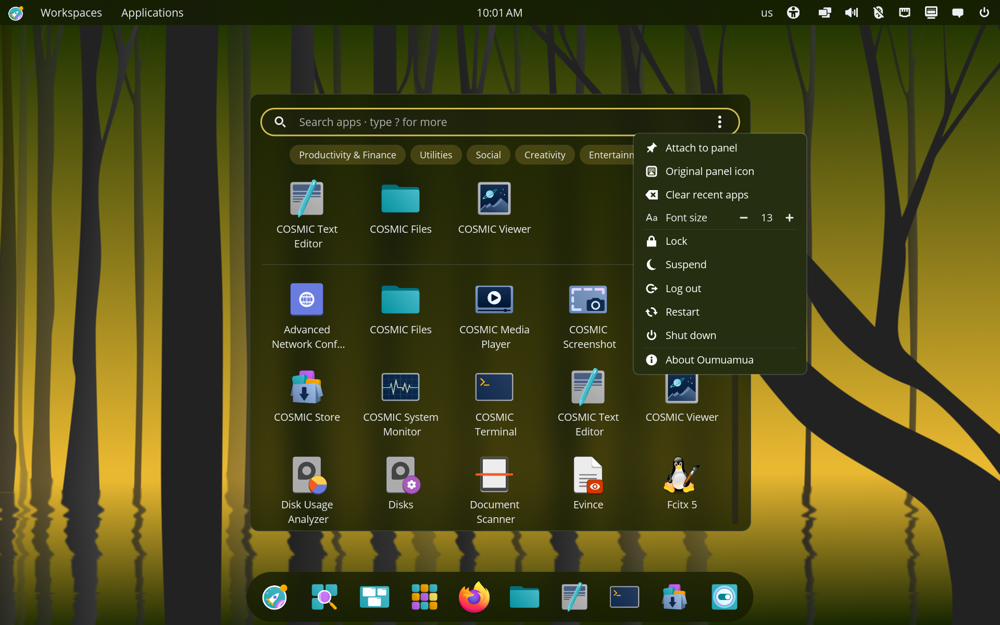

# Oumuamua para o desktop COSMIC™

[English](README.md) | **Português (Brasil)**

Um lançador de aplicativos em grade, com efeito de vidro fosco, para o desktop [COSMIC™](https://system76.com/cosmic), escrito em Rust com a [libcosmic](https://github.com/pop-os/libcosmic). Inspirado no [AppGrid do Plasma 6](https://github.com/xarbit/plasma6-applet-appgrid).













Este é um projeto da comunidade. Ele não é afiliado nem endossado pela System76.

- **Sempre centralizado.** Por padrão, a grade abre bem no meio da tela, não importa onde estejam o painel ou a dock.
- **Ou preso ao painel.** O menu ⋮ no campo de busca transforma a grade em um popup preso ao botão do painel, como um menu Iniciar, e de volta. Com o botão à esquerda de um painel inferior, ela abre como o menu Iniciar do Windows 7.
- **Layout no estilo do AppGrid.** Um campo de busca, categorias (Produtividade e finanças, Utilitários, Social, Criatividade, Entretenimento, Outros), uma linha com os aplicativos usados recentemente e uma grade rolável com todos os aplicativos. Os nomes dos aplicativos ocupam até duas linhas, como no AppGrid do Plasma, e uma dica mostra o nome completo quando ele é cortado.
- **Um campo de busca para tudo.** Digitar busca seus aplicativos e janelas abertas. Prefixos transformam o campo em outras ferramentas; digite `?` para ver todos:

  | Digite | O que faz |
  |---|---|
  | `= 2 × (3 + 4)` ou só `2+2` | Calculadora. Enter copia o resultado. |
  | `~/` | Navegar por arquivos e pastas. Tab completa. |
  | `find nome` | Encontrar arquivos e pastas na sua pasta pessoal. |
  | `recent` | Documentos abertos recentemente. |
  | `run comando` ou `t:comando` | Executar um comando no terminal. |
  | `:comando` | Executar um comando em segundo plano, sem janela. |
  | `ddg`, `g`, `w`, `yt`, `gh` + palavras | Buscar no DuckDuckGo, Google, Wikipédia, YouTube ou GitHub. |
  | `reiniciar`, `bloquear`, `desligar`… | Ações de sessão e energia. Com o desktop em português, os nomes em português funcionam; os em inglês (`reboot`, `lock`, `shut`…) funcionam sempre. |
  | parte do título de uma janela | Alternar para essa janela aberta. |

- **Rápido pelo teclado.** Comece a digitar para buscar. As setas e o Tab movem a seleção, Enter abre, Alt+1…9 abre um resultado direto, Esc fecha e PgUp/PgDn pulam uma tela.
- **Tamanho da fonte ajustável.** *Tamanho da fonte* no menu ⋮ vai de 9 a 20, como os botões de ajuste das Configurações do COSMIC. Todo o texto da grade, dos resultados e do menu acompanha, e as células crescem junto.
- **Vidro que segue as configurações do seu desktop.** A grade usa as próprias configurações de vidro fosco do COSMIC (*Configurações → Área de trabalho → Aparência → Vidro fosco*):
  - A grade centralizada segue a opção **Interface do sistema**.
  - O popup do painel segue a opção **Miniaplicativos**.
  - Os dois usam a intensidade do desfoque e a opacidade do vidro que você escolheu, e se atualizam na hora quando você as muda.
- **Opções de sessão e energia** no menu ⋮: Bloquear, Suspender, Encerrar sessão, Reiniciar e Desligar. Encerrar sessão, Reiniciar e Desligar pedem confirmação com o próprio diálogo do COSMIC.
- **Cabe em qualquer idioma.** O menu ⋮ e as categorias se ajustam ao texto traduzido, então nada quebra linha, rola ou fica cortado.
- **Traduzido** para português do Brasil, espanhol, francês e esperanto, com uma página Sobre (⋮ → *Sobre o Oumuamua*) que leva a este repositório.
- **Ícone próprio.** Uma escotilha com um planeta e um foguete, inspirada na arte do instalador do Pop!_OS. Vem colorido, para um painel inferior no estilo do Windows ou para a dock, ou monocromático, para combinar com os outros ícones do painel superior (troque no menu ⋮).
- **Funciona junto com o lançador do COSMIC.** O Oumuamua tem seus próprios plugins e configurações, e não substitui nem altera o Lançador nem a Biblioteca de aplicativos do COSMIC.

## Componentes

| Executável | O que é |
|---|---|
| `cosmic-ext-oumuamua` | O lançador centralizado. Roda em uma única instância: executá-lo de novo abre ou fecha a grade. Associe-o a uma tecla em *Configurações → Teclado → Atalhos personalizados*. |
| `cosmic-ext-oumuamua-applet` | O botão do painel, listado como *Oumuamua* em *Configurações → Área de trabalho → Painel → Miniaplicativos*. |

As configurações ficam salvas pelo cosmic-config em `~/.config/cosmic/io.github.broly1.Oumuamua/v1/`:

| Chave | Padrão | Significado |
|---|---|---|
| `position` | `Centered` | `Centered` (centralizado) ou `Panel` (preso ao painel) |
| `columns` | `5` | Ícones por linha |
| `rows` | `4` | Linhas visíveis de uma vez (o resto rola) |
| `icon_size` | `52` | Tamanho dos ícones em pixels (32–128) |
| `symbolic_icon` | `false` | Usar o ícone monocromático no painel |
| `font_size` | `13` | Tamanho da fonte dos nomes dos aplicativos (9–20); o resto do texto acompanha |
| `recent` | `[]` | IDs dos aplicativos abertos recentemente, do mais novo ao mais antigo |

As categorias vêm da chave `Categories=` de cada aplicativo (padrão freedesktop.org). Aplicativos de escritório e finanças vão para Produtividade e finanças, ferramentas de gráficos e desenvolvimento para Criatividade, navegadores, e-mail e chat para Social, jogos e players de mídia para Entretenimento, e ferramentas do sistema para Utilitários. O resto vai para Outros.

## Instalação

Um [justfile](./justfile) está incluído para o executor de comandos [casey/just][just]. Você precisa do Rust 1.90 ou mais novo e das dependências de compilação da libcosmic. No Pop!_OS / Ubuntu:

```sh
sudo apt install build-essential pkg-config just cmake libxkbcommon-dev libwayland-dev \
  libexpat1-dev libfontconfig-dev libfreetype-dev libegl-dev libdbus-1-dev
just
sudo just install
```

Depois adicione o *Oumuamua* ao painel ou à dock, ou execute `cosmic-ext-oumuamua`.

- `just` compila o aplicativo com a receita padrão `just build-release`
- `just run` compila e executa o lançador
- `just install` instala o projeto no sistema
- `just vendor` cria um tarball com as dependências incluídas
- `just build-vendored` compila usando as dependências desse tarball
- `just check` roda o clippy no projeto para procurar avisos do linter
- `just check-json` pode ser usado por IDEs com suporte a LSP

## Abrir com a tecla Super (Windows)

O COSMIC associa a tecla Super sozinha ao seu próprio lançador. Para abrir o Oumuamua no lugar dele, adicione isto a `~/.config/cosmic/com.system76.CosmicSettings.Shortcuts/v1/custom` (crie o arquivo se ele não existir; mantenha as outras entradas que já estiverem nele):

```ron
{
    (modifiers: [Super]): Spawn("cosmic-ext-oumuamua"),
}
```

Apertar Super de novo fecha a grade. O lançador do COSMIC continua disponível em Super+/. Você também pode criar um atalho personalizado para `cosmic-ext-oumuamua` em *Configurações → Teclado → Atalhos*.

## Tradutores

O Oumuamua usa o [Fluent][fluent] para traduções, do mesmo jeito que os aplicativos e miniaplicativos do próprio COSMIC. Cada idioma tem um arquivo, `i18n/<idioma>/cosmic_ext_oumuamua.ftl`. Esse mesmo arquivo também traduz o nome e a descrição do aplicativo na lista de miniaplicativos do painel e nas lojas de aplicativos.

| Idioma | Pasta |
|---|---|
| Inglês (original) | [`i18n/en`](./i18n/en) |
| Português do Brasil | [`i18n/pt-BR`](./i18n/pt-BR) |
| Espanhol | [`i18n/es`](./i18n/es) |
| Francês | [`i18n/fr`](./i18n/fr) |
| Esperanto | [`i18n/eo`](./i18n/eo) |

Para adicionar um idioma:

1. Copie a pasta `i18n/en` e renomeie-a com o código do seu idioma, por exemplo `de`, `it` ou `pt` (use uma região só quando fizer diferença, como em `pt-BR` ou `zh-Hant`). Veja os [códigos ISO 639-1][iso-codes].
2. Traduza o texto depois de cada `=`. Não mude os IDs antes do `=`. Veja o [guia do Fluent][fluent-guide] para a sintaxe.
3. Nas linhas `*-keywords`, mantenha o `;` entre as palavras e no final.
4. Deixe de fora as linhas que não precisam de tradução; o texto em inglês é usado no lugar.
5. Confira o resultado com `just run`, ou compile e instale com `just` e `sudo just install`. O Oumuamua usa o idioma do seu desktop (*Configurações → Hora e idioma → Região e idioma*).
6. Abra um pull request.

Para corrigir uma tradução existente, edite o arquivo dela e abra um pull request.

## Empacotamento

Ao empacotar para uma distribuição Linux, inclua as dependências localmente com a regra `vendor` e compile com elas usando a regra `build-vendored`. Na instalação, use as variáveis `rootdir` e `prefix` para mudar os caminhos.

```sh
just vendor
just build-vendored
just rootdir=debian/cosmic-ext-oumuamua prefix=/usr install
```

Recomenda-se criar um tarball do código-fonte com as dependências incluídas, o que normalmente se faz rodando `just vendor` no sistema hospedeiro antes de entrar no ambiente de compilação.

## Desenvolvedores

Desenvolvedores devem instalar o [rustup][rustup] e configurar o editor para usar o [rust-analyzer][rust-analyzer]. Rode `just check` (clippy) e `cargo fmt` antes de enviar mudanças.

## Como a centralização funciona

A grade centralizada é uma superfície de camada do Wayland em tela cheia, na camada overlay, com `exclusive_zone = -1`, para que painéis e docks não a desloquem. A libcosmic então reduz a superfície ao tamanho da grade com margens iguais em todos os lados, e o desfoque é pedido junto com essas margens, para que ele cubra só a grade. Clicar fora da grade a fecha.

## Como isto foi feito

Este projeto foi escrito com a ajuda de um assistente de programação com IA (Claude, da Anthropic), dirigido, testado e revisado pelo mantenedor. O código não se destina a ser enviado aos repositórios do COSMIC da System76, que não aceitam contribuições geradas por IA.

## Licença

GPL-3.0-only. Veja [LICENSE](LICENSE).

COSMIC™ é uma marca comercial da System76, Inc.

[fluent]: https://projectfluent.org/
[fluent-guide]: https://projectfluent.org/fluent/guide/hello.html
[iso-codes]: https://pt.wikipedia.org/wiki/ISO_639
[just]: https://github.com/casey/just
[rustup]: https://rustup.rs/
[rust-analyzer]: https://rust-analyzer.github.io/
